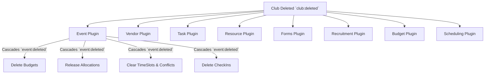

# CampusOS Event Catalog & Lifecycle Matrix

This document provides a comprehensive catalog of all system lifecycle events, payloads, publishers, and subscribers across CampusOS and its plugins.

---

## 1. EventBus Architecture

CampusOS uses a decoupled pub/sub architecture powered by `backend/src/core/event-bus.js`.

- **Async & Settled Delivery:** Listeners run asynchronously; failures in one subscriber do not crash the EventBus or prevent other subscribers from executing (`Promise.allSettled`).
- **Error Isolation:** Handlers log errors without taking down the Node process or triggering unhandled rejections.

---

## 2. Central Event Matrix

| Event Name                       | Publisher Plugin      | Payload Schema                                                                                          | Subscribers                                                                                         | Purpose & Action                                                                                                                                                                                                                                                                                                                                                                                                                                                                                                                                       |
| :------------------------------- | :-------------------- | :------------------------------------------------------------------------------------------------------ | :-------------------------------------------------------------------------------------------------- | :----------------------------------------------------------------------------------------------------------------------------------------------------------------------------------------------------------------------------------------------------------------------------------------------------------------------------------------------------------------------------------------------------------------------------------------------------------------------------------------------------------------------------------------------------- |
| `club:deleted`                   | `plugins/club`        | `{ clubId: string }`                                                                                    | `event` `vendor` `task` `resource` `forms` `recruitment` `budget` `scheduling` | **Primary Club Cascade:** • `event`: Deletes all events for club (cascades `event:deleted`) • `vendor`: Deletes all vendors associated with club • `task`: Deletes all tasks associated with club • `resource`: Deletes all equipment/assets owned by club • `forms`: Deletes all club forms and associated responses • `recruitment`: Deletes all club recruitment campaigns and candidate applications • `budget`: Deletes any remaining club event budgets • `scheduling`: Deletes all room/venue schedules for club events |
| `user:deleted`                   | `plugins/auth`        | `{ userId: string }`                                                                                    | `club` `event` `task` `forms` `recruitment` `checkin`                                | **User Data Cleanup:** • `club`: Revokes club memberships and roles • `event`: Cancels registrations and decrements capacity counts • `task`: Unassigns user from tasks (`assigneeId` and `assigneeName` set to `null`) • `forms`: Deletes form responses submitted by user • `recruitment`: Deletes candidate application profiles for user • `checkin`: Deletes attendance and QR check-in records                                                                                                                                 |
| `event:deleted`                  | `plugins/event`       | `{ eventId: string }`                                                                                   | `budget` `resource` `scheduling` `checkin` `vendor`                                     | **Event Cascade:** • `budget`: Deletes budget and associated expenses • `resource`: Releases resource equipment allocations • `scheduling`: Deletes time slots and conflict records • `checkin`: Deletes attendee check-in records • `vendor`: Clears vendor assignments for event                                                                                                                                                                                                                                                      |
| `event:created`                  | `plugins/event`       | `{ eventId: string, clubId: string, actorId: string, title: string }`                                   | `activity`                                                                                          | Audit trail logging                                                                                                                                                                                                                                                                                                                                                                                                                                                                                                                                    |
| `event:published`                | `plugins/event`       | `{ eventId: string, clubId: string, actorId: string, title: string }`                                   | `activity`                                                                                          | Audit trail logging                                                                                                                                                                                                                                                                                                                                                                                                                                                                                                                                    |
| `club:proposed`                  | `plugins/club`        | `{ data: ClubObject }`                                                                                  | `club` (mail listener)                                                                              | Generates and sends club verification email                                                                                                                                                                                                                                                                                                                                                                                                                                                                                                            |
| `club:roles_provisioned`         | `plugins/club`        | `{ clubId: string, roles: { coordinatorId: string, volunteerId: string } }`                             | `event` `budget` `task` `resource`                                                         | Assigns default module permissions (`event:manage`, `budget:view`, `task:view`, `resource:view`) to club roles                                                                                                                                                                                                                                                                                                                                                                                                                                         |
| `task:created`                   | `plugins/task`        | `{ taskId: string, clubId: string, data: TaskObject }`                                                  | `activity`                                                                                          | Audit trail logging                                                                                                                                                                                                                                                                                                                                                                                                                                                                                                                                    |
| `task:status_updated`            | `plugins/task`        | `{ taskId: string, clubId: string, status: string, data: TaskObject }`                                  | `activity`                                                                                          | Audit trail logging                                                                                                                                                                                                                                                                                                                                                                                                                                                                                                                                    |
| `form:created`                   | `plugins/forms`       | `{ formId: string, entityType: string, entityId: string }`                                              | `recruitment`                                                                                       | Form registration tracking                                                                                                                                                                                                                                                                                                                                                                                                                                                                                                                             |
| `forms:response_submitted`       | `plugins/forms`       | `{ formId: string, userId: string, responseId: string, answers: object }`                               | `recruitment`                                                                                       | Automatically creates candidate application for recruitment campaigns linked to the form                                                                                                                                                                                                                                                                                                                                                                                                                                                               |
| `recruitment:candidate_selected` | `plugins/recruitment` | `{ entityType: string, entityId: string, userId: string, campaignId: string, onboardRoleName: string }` | `club`                                                                                              | Automatically adds approved candidate as a club member with specified role                                                                                                                                                                                                                                                                                                                                                                                                                                                                             |
| `budget:created`                 | `plugins/budget`      | `{ budgetId: string, eventId: string, totalAllocation: number }`                                        | `activity`                                                                                          | Audit trail logging                                                                                                                                                                                                                                                                                                                                                                                                                                                                                                                                    |
| `resource:allocated`             | `plugins/resource`    | `{ resourceId: string, eventId: string, allocationId: string, quantity: number }`                       | `activity`                                                                                          | Audit trail logging                                                                                                                                                                                                                                                                                                                                                                                                                                                                                                                                    |

---

## 3. Cascade Rules & Guarantees

### Club Deletion Sequence

### User Deletion Cleanup

When an account is deleted, personal identifying entries, responses, and allocations are removed without deleting shared club resources:

1. **Club Memberships:** Memberships in all clubs are revoked (`removeAllUserMemberships`).
2. **Tasks:** Tasks created or assigned to the user are unassigned (`assigneeId = null`, `assigneeName = null`). The tasks remain intact so club workflows are uninterrupted.
3. **Event Registrations:** Registrations are cancelled and event counters (`registrationsCount`) are decremented.
4. **Forms & Applications:** User form submissions and recruitment candidate records are permanently purged.
5. **Check-ins:** User QR check-in records are deleted.
